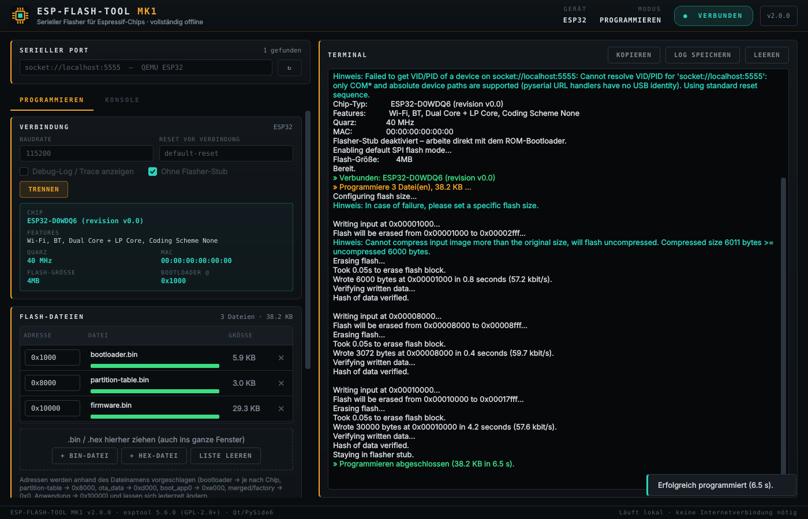

# ESP-Flash-Tool MK1

Eigenständiges **Windows-Programm** zum Flashen von Espressif-Chips – voll funktionaler, komplett **offline** laufender Ersatz für [esptool-js](https://espressif.github.io/esptool-js/), im Dashboard-Design.
Kein Browser, kein lokaler Webserver: eine einzelne `.exe` mit eigener Oberfläche (Qt) und dem offiziellen **esptool** von Espressif als Kern.



**Version:** 2.0.0 · **esptool:** 5.6.0

## Funktionen

Alles, was die esptool-js-Seite kann:

- **Verbinden** mit ESP32, ESP32-S2/S3, C2/C3/C5/C6/C61, H2/H4, P4, ESP8266 u. a. (Baudrate frei wählbar, 115200 – 921600 voreingestellt)
- **Programmieren** beliebig vieler `.bin`-Dateien mit frei wählbarer Adresse, MD5-Prüfung nach dem Schreiben
- **Intel-HEX-Dateien** (`.hex`) – jedes Segment wird mit seiner Adresse übernommen
- Flash-Modus, -Frequenz und -Größe (Auswahl passend zum erkannten Chip)
- **Gesamten Flash löschen** bzw. vor dem Programmieren komplett löschen
- **Konsole** (serieller Monitor) mit automatischer Wiederverbindung, Reset-Taste und IDF-Log-Einfärbung (E/W/I)
- Debug-/Trace-Ausgabe

Zusätzlich:

- **Port-Auswahl mit Automatik** – die Liste aktualisiert sich selbst, ein neu eingestecktes Board wird automatisch ausgewählt
- **Drag & Drop** von `.bin`/`.hex` ins Fenster oder auf die exe (bzw. „Öffnen mit“)
- **Automatische Adressvorschläge** anhand des Dateinamens (bootloader → chipabhängig 0x0/0x1000/0x2000, partition-table → 0x8000, ota_data → 0xd000, boot_app0 → 0xe000, merged/factory → 0x0, Anwendung → 0x10000); manuell geänderte Adressen werden pro Dateiname gemerkt
- Prüfung auf doppelte, **überlappende** oder zu große Adressbereiche
- **Chip-Infokarte** (Chip, Features, Quarz, MAC, Flash-Größe, Bootloader-Adresse)
- **Flash auslesen (Backup)** als `.bin` – ganzer Flash oder Bereich
- „**Unveränderte Inhalte überspringen**“ (schnelles erneutes Flashen), Komprimierung abschaltbar, Reset-Modus vor/nach dem Flashen, Betrieb **ohne Flasher-Stub**
- **Text senden** in der Konsole (CR+LF / LF / CR), Tastatureingabe direkt im Terminal, Zeitstempel
- Terminal-Inhalt **kopieren / als Log speichern**
- Alle Einstellungen bleiben erhalten

## Benutzung

1. ZIP aus dem GitHub-Release (oder dem Actions-Artefakt) entpacken.
2. `ESP-Flash-Tool-MK1.exe` starten.
3. Board per USB anschließen – der Port wird automatisch ausgewählt.
4. **Verbinden**, Dateien hinzufügen, Adressen prüfen, **Programmieren**.

Treiber für USB-UART-Wandler (CP210x, CH34x, FTDI) müssen wie bei jedem Flash-Tool installiert sein. Boards mit nativem USB (ESP32-S3/C3/C6 …) funktionieren ohne Zusatztreiber.

Falls der Chip nicht antwortet: **BOOT**-Taste gedrückt halten, „Verbinden“ klicken und loslassen, sobald „Connecting…“ erscheint.

## Projektaufbau

```
.github/workflows/build-exe.yml   GitHub Actions: exe bauen → Selbsttest → ZIP / Release
app.py                            Startpunkt (Qt-Anwendung, Selbsttest)
espflash/mainwindow.py            Oberfläche und Abläufe
espflash/session.py               Chip-Verbindung, Flashen, Löschen, Auslesen (esptool-API)
espflash/console.py               Serieller Monitor mit Auto-Reconnect
espflash/terminal.py              Terminal-Anzeige mit ANSI-Farben
espflash/logbridge.py             leitet esptool-Ausgaben & Fortschritt in die Oberfläche
espflash/theme.py                 Dashboard-Design (Stylesheet)
tools/make_version_file.py        Windows-Versionsinfo für die exe
assets/                           Icon und Screenshot
requirements.txt                  feste Versionen der Abhängigkeiten
```

## Build per GitHub Actions

- Jeder Push auf `main`/`master` erzeugt das Artefakt `ESP-Flash-Tool-MK1-v<Version>-windows.zip` (exe + README + Lizenzen).
- Ein Tag `v*` (z. B. `v2.0.0`) erzeugt zusätzlich ein GitHub-Release mit der ZIP-Datei. Tag und `APP_VERSION` in `espflash/__init__.py` müssen übereinstimmen.
- Die fertige exe wird im Workflow per `--selftest` geprüft (Oberfläche, Chip-Definitionen, Flasher-Stubs).

## Lokal starten / bauen

```bash
pip install -r requirements.txt
python app.py

pip install pyinstaller
pyinstaller --onefile --windowed --name ESP-Flash-Tool-MK1 --icon assets/icon.ico ^
  --add-data "assets;assets" --collect-data esptool --collect-submodules esptool.targets app.py
```

## Lizenzen

Der Flash-Kern ist [esptool](https://github.com/espressif/esptool) von Espressif (GPL-2.0-or-later); die gebaute exe steht damit ebenfalls unter GPL-2.0-or-later. Übersicht aller Bestandteile: [THIRD_PARTY_LICENSES.md](THIRD_PARTY_LICENSES.md).
